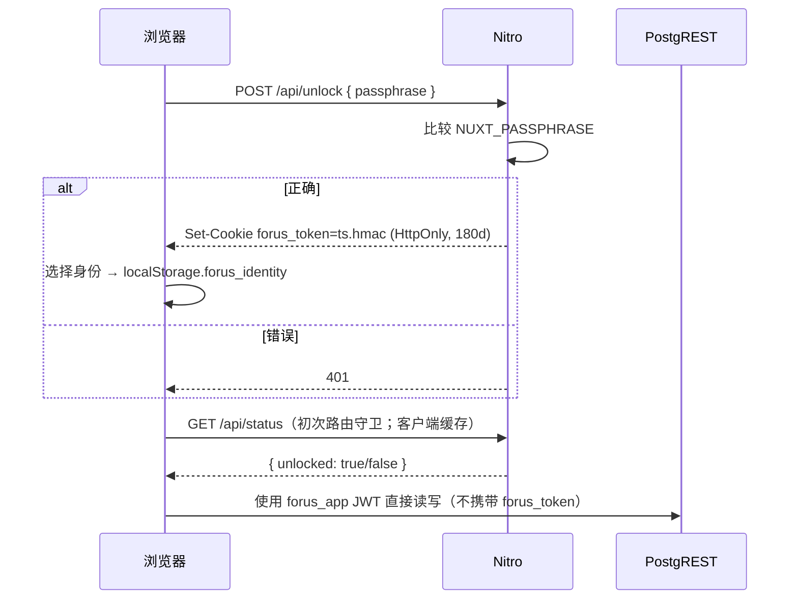

# 架构说明

## 技术栈与运行模型

- **Nuxt 3**（SSR 模式）+ Vue 3 `<script setup>` + TypeScript。
- **Nitro** 提供 13 个服务端接口（`server/api/`）：鉴权、信件、小猫、上传/媒体删除与健康检查。
- **自建 Postgres + PostgREST**：数据库、REST 接口；浏览器用 `forus_app` JWT 直连，服务端敏感数据用 `forus_service` JWT。
- **本地上传目录**：`/opt/forus/uploads`（容器内 `/data/uploads`），nginx/Nitro 通过 `/uploads/` 提供。
- **30 秒轮询**：替代 Realtime；写操作后本地立即刷新。
- 部署目标为 Node 服务器（`node .output/server/index.mjs`）或 Vercel。

## 目录结构

```
Forus/
├─ app.vue                  NuxtLayout + NuxtPage 入口
├─ error.vue                404 / 错误页
├─ update.sh                服务器一键更新入口（L1–L5 校验）
├─ layouts/default.vue      主题背景 Canvas、生日氛围、主题切换器
├─ pages/                   9 个页面（含 2 个导航隐藏页）
├─ components/              封面、导航、各内容墙、小猫、庆祝动画
├─ composables/             数据逻辑（PostgREST 读写、轮询、身份、主题、天气…）
├─ middleware/unlocked.ts   唯一路由守卫
├─ server/
│  ├─ api/                  unlock / status / lock / health / cat / cat-messages / letters / upload / media
│  ├─ routes/               uploads 本地文件服务（开发环境）
│  └─ utils/                token、safe-compare、rate-limit、require-unlock、supabase-admin、
│                            uploads-dir、letters、date、cat-brain
├─ data/site.ts             站点静态配置（名字、起始日、生日、封面文案）
├─ utils/                   日期、图片压缩、时间格式化、错误提示、上传路径解析（Nuxt 自动导入）
├─ types/                   共享类型
├─ supabase/                历史 Supabase SQL（自建环境使用角色/JWT 配置）
├─ assets/css/main.css      主题变量与全局样式
└─ public/                  静态资源（favicon、樱花背景图）
```

## 渲染与数据流

1. Nitro 先渲染页面 HTML。首页在 SSR 阶段只输出空壳与前端脚本，封面 `CurtainIntro` 要等客户端 `onMounted` 后才渲染；主界面同样在解锁后才挂载，大部分业务数据在客户端 `onMounted` 阶段才从本地 PostgREST 拉取。
2. 浏览器挂载后：
   - `GET /api/status` 确认解锁状态（客户端会话内只查一次）；
   - 各 composable 通过 `useDb()` 直接访问本地 PostgREST `/db/rest/v1/*`；
   - 选择过身份后，从 `localStorage.forus_identity` 恢复。
3. 大部分写操作也是浏览器直连 PostgREST（`forus_app` JWT）。以下数据走 Nitro + `SUPABASE_SERVICE_ROLE_KEY`（`forus_service` JWT）：
   - `/api/letters/*`：信件的读取、写入、修改、撤回；
   - `/api/cat`、`/api/cat-messages`：小猫对话读取与持久化；
   - `/api/upload`、`/api/media/delete`：本地文件写入与删除。
   - `letters` / `cat_messages` 对 `forus_app` 无授权，浏览器无法绕过服务端规则。

```
浏览器 ──(HttpOnly Cookie)──> Nitro /api/status /unlock /lock /health /letters /cat /upload /media
   │
   ├──(forus_app JWT)──> nginx /db/rest/v1 ──> PostgREST ──> Postgres
   │                        （notes / media / memos / likes …）
   │
   └──(forus_service JWT)──> Nitro ──> PostgREST ──> letters / cat_messages
```

## 鉴权流程



要点：

- `forus_token` 的 payload 只有签发时间戳，签名是 `HMAC-SHA256(payload, NUXT_AUTH_SECRET)`，格式 `<base64url(ts)>.<base64url(sig)>`。
- Cookie 设置为 `HttpOnly`、`SameSite=Lax`、生产环境 `Secure`、`path=/`、180 天。
- `/api/unlock` 有按 IP 的失败次数限流；暗号与签名比较使用恒定时间比较。
- 守卫 `middleware/unlocked.ts`：除 `/` 外的页面会在 SSR 和客户端都检查状态；客户端首次请求 `/api/status` 后缓存到 `usePassphrase()`，后续导航不再重复请求。服务端使用 `useRequestFetch()` 自动转发 Cookie。
- 前端**不导入** `server/utils/token.ts`，避免 Node `crypto` 被打进浏览器包。
- `/api/health` 是公开接口，只返回 `ok/time/commit`（`package.json` 带 `version` 时也返回 `version`），不返回业务数据；`commit` 来自 `.data/deploy-info.json`。
- 身份（`you` / `npy`）只是 UI 偏好，不是权限凭证；信件接口会校验发件人/到期时间，但身份本身由已解锁设备声明。

## 状态管理

项目没有 Pinia。状态分两类：

1. **模块级单例**（在 `export function` 外声明 `ref`）：
   - `usePassphrase`：`unlocked`、`ready`、进行中的请求；
   - `useIdentity`：当前身份；
   - `useTheme`：当前主题；
   - `useToday`：响应式「今天」；
   - `useCover`：封面是否可见（用于暂停背景 Canvas）。
2. **每次调用新建状态**：其余业务 composable（`useNotes`、`useMedia`、`useGoals` …）都在函数内部 `ref`，并调用 `usePolling(fetchAll)` 做首次拉取与 30 秒轮询。
   - 因此它们**只能在组件 `setup()` 期间调用**，不能在事件回调里调用。
   - 同一个 composable 被两个组件调用会产生两份状态和两个轮询定时器。
   - 数据库客户端统一通过 `useDb()` 获取；项目没有生成 PostgREST 类型，`useDb()` 返回 `any` 以避免 insert/update 参数退化为 `never`。
3. **纯工具**：`useMediaUpload` 只提供上传/删除函数，不注册生命周期；留言墙用它上传图片，因此不会额外轮询 `media` 表。

## 轮询同步

`composables/usePolling.ts` 统一处理：

- 挂载时立即 `fetchAll()`；
- 每 30 秒刷新一次；页面隐藏时跳过请求；
- 切回前台立即刷新；
- 组件卸载时清理定时器。

每个写操作成功后还会 `await fetchAll()`，保证本机操作立即显示。涉及：`notes`、`media`、`memos`、`memo_comments`、`goals`、`likes`、`adores`、`dislikes`、`calendar_marks`、`pushbacks`、`milestones`。

`pokes` 仍由 `PokeAlert` / `TogetherCard` 自己的定时器轮询；`letters` 与 `cat_messages` 走服务端接口，不参与前端轮询。

## 页面与导航

- `layouts/default.vue` 提供背景层、主题切换器；页面自己渲染 `<NavBar />`。
- 导航栏在左下角，浮出菜单；锁定按钮调用 `POST /api/lock` 并跳回 `/`。
- `/calendar`、`/push` 路由存在且受守卫保护，但不在 `NavBar.links` 中，属于隐藏页面。

## 主题

- `useTheme()` 在客户端挂载时读取 `localStorage.forus_theme`，给 `<html>` 设置 `data-theme`（多个组件调用时只初始化一次）。
- `main.css` 用 CSS 变量（`--bg-*`、`--accent*`、`--positive*`、`--negative*`、`--warning*`）驱动背景与状态色；`tailwind.config.ts` 把 `accent` / `accent-soft` / `positive` / `negative` / `warning` 映射到这些变量，因此组件类名（如 `bg-accent/15`、`text-negative`）会跟随主题。
- 少数中性色仍使用 Tailwind 的 `slate` / `white`；装饰性的 `pink-*` 保留在 Adore 渐变中。
- 背景特效：

| 主题 | Canvas | 交互 |
|------|--------|------|
| `star` | `MeteorCanvas` | 鼠标划出星尘 |
| `sakura` | `SakuraCanvas` | 鼠标划出花瓣 |

- 两个 Canvas 都监听 `visibilitychange`，标签页隐藏时暂停动画；`MeteorCanvas` 尊重 `prefers-reduced-motion`。

## 日期与庆祝

`utils/date.ts`：

- `daysSince` / `daysUntil` / `togetherDays` / `togetherDuration`；
- `nextAnniversary`：从今年开始找第一个不早于今天的周年；
- `todayCelebration`：周年 > 农历生日（在野）> 公历生日 > 整百天；
- 农历生日用 `lunar-javascript` 的 `Solar.fromDate(now).getLunar()`，闰月返回负数月份，因此只匹配正数 6 月可排除闰六月。

## 小猫 AI

请求链路：

1. `CatChat.vue` → `useCat.send()`：先在本地显示用户消息，然后 `POST /api/cat`，只发送 `{ message }`。
2. `server/api/cat.post.ts`：
   - 校验 `forus_token`，限制消息 500 字；
   - 从 `cat_messages` 读取最近 10 条作为历史（服务端读取，客户端无法注入 role）；
   - 组装北京时间、在一起天数、生日等基础上下文；
   - `matchTriggers(message)` 命中关键词后，用 service JWT 查询 `notes` / `goals` / `likes`；
   - 替换 `CAT_PERSONA` 的 `{context}`；
   - 先持久化用户消息，再调用 `${catApiBase}/chat/completions`（`temperature 1.1`、`max_tokens 500`、20 秒超时）；
   - 成功后持久化小猫回复，失败时记录日志并返回兜底文案。
3. `GET /api/cat-messages` 返回最近 100 条，前端 `useCat.fetchHistory()` 用于初始加载。

配置项在 `nuxt.config.ts` 的 `runtimeConfig`：`catApiBase`、`catApiKey`、`catModel`，对应 `NUXT_CAT_API_BASE`、`NUXT_CAT_API_KEY`、`NUXT_CAT_MODEL`。这些接口还需要 `SUPABASE_SERVICE_ROLE_KEY` 读写 `cat_messages`。

## 新增一个功能页的推荐步骤

1. 在 `supabase/` 新建幂等 SQL（建表、索引、GRANT；自建环境按需给 `forus_app` 授权）。
2. 在 `composables/` 新建 `useXxx.ts`：用 `useDb()` 获取客户端，`ref` + `fetchAll` + 增删改（写操作检查 `error` 并抛错，成功后 `await fetchAll()`）+ `usePolling(fetchAll)`。
3. 在 `pages/` 新建页面，写 `definePageMeta({ middleware: 'unlocked' })`，渲染 `<NavBar />`，写操作 `await` 并用 `notifyError` 提示。
4. 如需入口，在 `components/NavBar.vue` 的 `links` 中添加；不需要就保持隐藏。
5. 需要服务端权限的数据，新增 `server/api/*` 接口并使用 `requireUnlocked` + `adminRest`，不要暴露 service JWT。
6. 运行 `npm run build && npm run typecheck && npm run test && npm run lint`。
